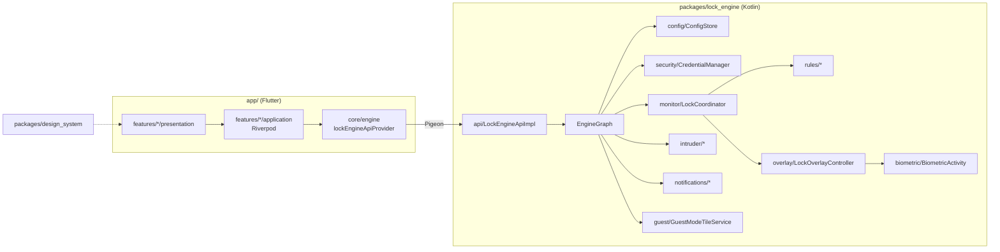
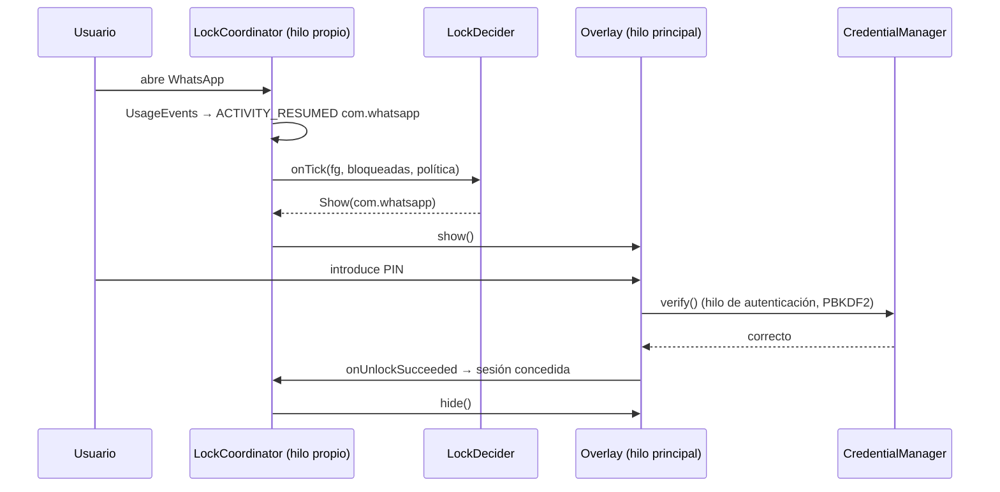

# Arquitectura de Sigilo

## 1. Visión general

Hay dos mitades que se comunican a través de un contrato tipado (Pigeon):

- **Flutter (Dart)**: toda la experiencia de la app (onboarding, ajustes,
  perfiles, modo invitado, intrusos...). Solo funciona mientras la app está
  abierta.
- **Motor nativo (Kotlin)**: detecta la app en primer plano y muestra la
  pantalla de bloqueo. Funciona siempre, aunque Flutter no esté cargado.

**Regla clave:** la configuración pertenece al motor nativo (`ConfigStore`).
Flutter la lee y la modifica a través de la API, pero el servicio nunca
depende de que Flutter esté en ejecución.

## 2. Módulos Flutter

| Módulo | Responsabilidad |
|---|---|
| `packages/design_system` | Tokens (espaciado, radios, `LockThemes`), `AppTheme` Material 3 y componentes sin lógica de negocio: `PinPad`, `PinDots`, `PatternLock`, `Shake`, `GradientBackdrop`, `StatTile`... |
| `packages/lock_engine` (Dart) | Código generado por Pigeon (`LockEngineHostApi` + modelos). |
| `app/lib/core` | `engine/` (proveedor de la API y `copyWith` de modelos), `session/` (bloqueo de la propia app), `router/` (go_router + reglas de redirección), `utils/`, `widgets/` compartidos. |
| `app/lib/features/<x>` | Una carpeta por función: `application/` (estado con Riverpod) y `presentation/` (pantallas y widgets). |

Funciones: `onboarding`, `auth` (bloqueo, creación/cambio de credencial,
recuperación), `apps`, `profiles`, `guest_mode`, `intruders`, `activity`,
`permissions`, `settings`, `home`.

### Estado (Riverpod 3)

- `lockEngineApiProvider`: único punto de acceso al motor; los tests lo
  sustituyen por `FakeEngineApi`.
- `AsyncNotifier` por función (`SettingsController`, `ProfilesController`,
  `GuestController`) con cambios optimistas.
- `appResumeTickProvider` aumenta al volver a primer plano y refresca los
  proveedores que dependen del sistema (permisos, fotos, historial).
- `AppSessionController` bloquea Sigilo al pasar a segundo plano, salvo que
  se esté concediendo un permiso en Ajustes (`keepUnlockedDuringExternalAction`).

### Navegación

`resolveRedirect` es una función pura (con tests):
sin credencial → onboarding · bloqueada → `/lock` o `/recover` ·
desbloqueada → inicio (o la ruta pendiente, p. ej. `/guest` desde el mosaico).

## 3. Motor nativo (Kotlin)

Solo usa APIs del framework de Android, sin androidx. Así el APK es más
pequeño, el overlay aparece al instante y no hay conflictos de versiones con
otros plugins.

| Paquete | Clases | Responsabilidad |
|---|---|---|
| `model` | `Models.kt` | Modelo de dominio independiente de Pigeon. |
| `rules` | `ScheduleEvaluator`, `LockRules`, `SessionManager`, `LockDecider` | Lógica pura (con tests): horarios, apps bloqueadas efectivas, sesiones de desbloqueo y la máquina de estados mostrar/ocultar. |
| `security` | `CredentialManager`, `CredentialHasher`, `KeystorePepper`, `CredentialPolicy`, `LockoutPolicy`, `RecoveryCodes` | Credencial propia, bloqueo progresivo y recuperación. |
| `monitor` | `AppMonitorService`, `LockCoordinator`, `ForegroundAppDetector` | Servicio en primer plano, bucle de 250 ms en su propio hilo y detección por `UsageEvents`. |
| `overlay` | `LockOverlayController`, `LockScreenView`, `PinPadView`, `PatternView`, `FakeCrashView`, `LockTheme` | Pantalla de bloqueo como ventana `TYPE_APPLICATION_OVERLAY`, construida por código. |
| `biometric` | `BiometricGate`, `BiometricActivity` | `BiometricPrompt` con `CryptoObject` ligado a una clave invalidable. |
| `intruder` | `IntruderCaptureActivity`, `IntruderCamera`, `IntruderStore` | Foto con Camera2 desde una actividad invisible; almacenamiento privado. |
| `notifications` | `PrivacyNotificationListener`, `EngineNotifications` | Ocultar notificaciones y canales propios. |
| `guest` | `GuestModeTileService` | Mosaico de Ajustes rápidos. |
| `apps` | `AppCatalog` | Apps del launcher, iconos y paquetes de sistema (launcher, teléfono, teclados...). |
| `config` | `ConfigStore`, `ConfigJson` | Configuración persistente con *listeners*. |
| `system` | `PermissionsManager`, `ActivityLog`, `BootReceiver` | Permisos, historial y arranque tras reiniciar. |
| `api` | `LockEngineApiImpl`, `Mappers`, `LockEngineApi.g.kt` | Implementación del contrato Pigeon (solo traduce y delega). |
| raíz | `EngineGraph`, `LockEnginePlugin` | Contenedor de dependencias y punto de entrada del plugin. |

### Flujo de bloqueo

- **Paquetes transitorios** (Sigilo, System UI, selector de compartir,
  teclados, diálogos de permisos) no cuentan como "salir" de la app.
- **Nunca se bloquean** el launcher, el teléfono, los teclados ni System UI,
  para no impedir llamadas ni dejar el móvil inutilizable.
- **Sesiones** (`SessionManager`): `IMMEDIATELY` revoca al salir,
  `AFTER_TIMEOUT` tolera ausencias cortas, `ON_SCREEN_OFF` dura hasta apagar
  la pantalla. Apagar la pantalla revoca siempre todas las sesiones.

## 4. Modelo de seguridad

1. **Independencia del sistema**: la credencial se verifica con un hash
   propio; nunca se usa `DEVICE_CREDENTIAL` ni el PIN del teléfono.
2. **Almacenamiento**: `PBKDF2WithHmacSHA256` (60 000 iteraciones, sal de
   16 bytes) seguido de un HMAC con una clave no exportable del Android
   Keystore. Copiar el archivo de preferencias no permite probar PINs fuera
   del teléfono. La comparación es en tiempo constante.
3. **Fuerza bruta**: 4 fallos libres; desde el 5.º, espera de 30 s que se
   duplica en cada fallo (máximo 15 min). El estado se escribe con `commit()`
   y lo comparten el overlay y la app.
4. **Recuperación**: código de 60 bits sin el pepper del Keystore, para que
   siga funcionando aunque el Keystore pierda la clave. Al usarlo, se rota.
5. **Biometría**: solo clase 3, con un `CryptoObject` cuya clave tiene
   `setInvalidatedByBiometricEnrollment(true)`. Si alguien con el PIN del
   teléfono añade su huella, la biometría de Sigilo se desactiva y se
   registra en el historial.
6. **Fugas**: `FLAG_SECURE` en la app, el overlay y la actividad biométrica;
   `allowBackup=false` y reglas de extracción de datos; sin permiso de
   Internet; fotos de intrusos en `filesDir` (no en la galería).

## 5. Decisiones técnicas

| Decisión | Motivo |
|---|---|
| `UsageStatsManager` en lugar de Accesibilidad | Google Play restringe la Accesibilidad para usos que no son de accesibilidad. |
| Overlay en lugar de una Activity de bloqueo | Aparece al instante y no choca con las restricciones de lanzar actividades desde segundo plano (Android 10+/15). |
| Pantalla de bloqueo nativa (no Flutter) | No hay que arrancar un motor de Flutter en el servicio: menor latencia y memoria. El diseño se mantiene coherente con `LockThemes` compartidos. |
| Actividad aparte para biometría y cámara | `BiometricPrompt` y la cámara exigen una Activity en primer plano. Con el overlay visible, Android permite lanzarla, y usa su propia `taskAffinity` para volver a la app protegida al cerrarse. |
| Configuración en el lado nativo | El servicio arranca tras reiniciar el móvil sin Flutter. |
| Pigeon | Tipos y errores comprobados en compilación en lugar de *strings* en *method channels*. |
| Lógica pura separada (`rules`, `security`) | Se prueba en la JVM sin dispositivo. |

## 6. Cómo añadir una función

1. Si necesita datos nativos, amplía `pigeons/lock_engine_api.dart` y
   regenera con Pigeon.
2. Implementa la lógica en un paquete Kotlin (pura en `rules/` o
   `security/` si es posible, con tests) y expónla en `LockEngineApiImpl`.
3. Crea `app/lib/features/<función>/application` (proveedores/notifiers) y
   `presentation` (pantallas), y registra la ruta en `core/router`.
4. Añade el método al `FakeEngineApi` de los tests y cubre el flujo.

## 7. Plan para iOS

iOS no permite dibujar sobre otras apps. La versión iOS usaría:
`FamilyActivityPicker` para elegir apps, `ManagedSettingsStore.shield` para
el bloqueo (pantalla del sistema personalizable con
`ShieldConfigurationDataSource`), `DeviceActivityMonitor` para los horarios
y una notificación que abre Sigilo para autenticarse con la credencial
propia y retirar el escudo temporalmente. Requiere el permiso
`com.apple.developer.family-controls` de Apple.
